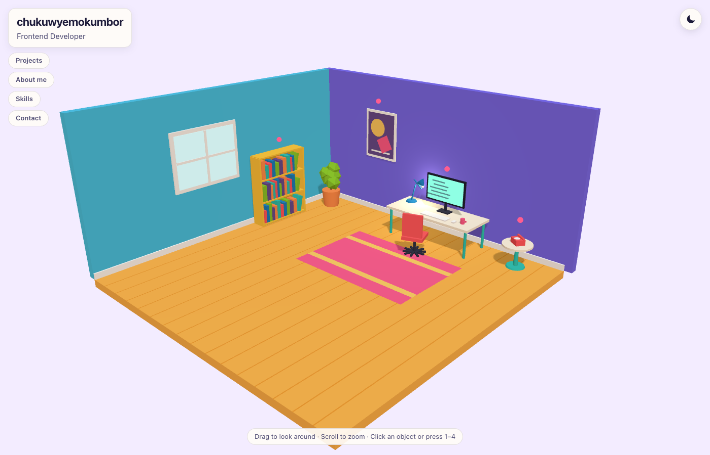
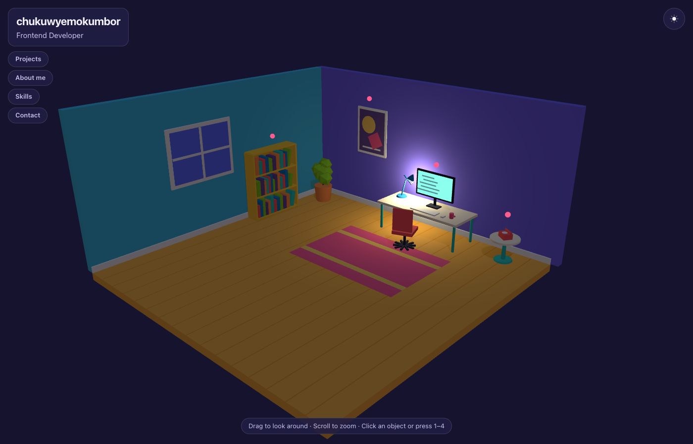
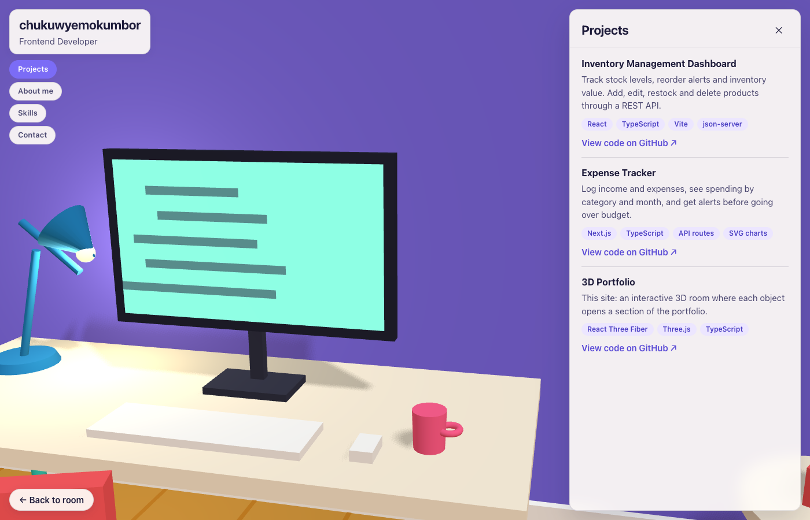
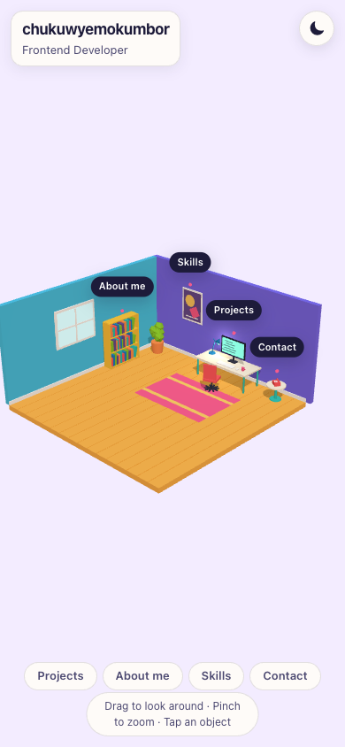

# 3D Portfolio

An interactive 3D portfolio built with React Three Fiber. Explore a colourful low-poly room and click the monitor, bookshelf, poster or phone to open my projects, about, skills and contact sections.



| Night mode | Projects close-up |
| --- | --- |
|  |  |

<p align="center">
  
</p>

## Features

- **A hand-built 3D room**: every object is made from simple shapes in code (no model files to download)
- **Clickable objects**: hover to highlight and label an object, click to fly the camera to a close-up and open its section
  - Monitor → **Projects** · Bookshelf → **About me** · Poster → **Skills** · Phone → **Contact**
- **Orbit controls with limits**: drag to look around and scroll or pinch to zoom, without ending up under the floor or behind a wall
- **Intro fly-in** and smooth camera moves, using frame-rate-independent easing
- **Day/night toggle**: eased lighting, with the desk lamp and monitor lighting the room at night. It follows your system theme on first visit.
- **Loading screen**: three.js is loaded in its own chunk, so the first download stays small
- **2D fallback**: browsers without WebGL (or a scene that fails to start) get a plain, fully readable version of the portfolio
- **Responsive**: on phones the camera frames the room for a tall screen, panels become a bottom sheet, and labels stay visible because there's no hover
- **Accessible**:
  - a section menu and keyboard shortcuts (`1`–`4` to open, `←` / `→` to switch, `Esc` to go back)
  - focus moves into panels and back to the menu
  - respects `prefers-reduced-motion` (no fly-throughs or bobbing)
  - a text description for the canvas

## Tech stack

- [React 19](https://react.dev/) + [TypeScript](https://www.typescriptlang.org/)
- [React Three Fiber](https://r3f.docs.pmnd.rs/) and [drei](https://drei.docs.pmnd.rs/) on top of [three.js](https://threejs.org/)
- [Vite](https://vite.dev/)
- Plain CSS with custom properties

## Getting started

You need [Node.js](https://nodejs.org/) 20.19 or newer.

```bash
git clone https://github.com/chukuwyemokumbor/3D_portfolio.git
cd 3D_portfolio
npm install
npm run dev
```

Then open the URL it prints (usually http://localhost:5173).

| Command | What it does |
| --- | --- |
| `npm run dev` | Starts the development server |
| `npm run build` | Type-checks and builds for production into `dist/` |
| `npm run preview` | Serves the production build locally |
| `npm run lint` | Runs ESLint |

## Make it yours

All the text lives in [`src/data/profile.ts`](src/data/profile.ts): name, role, about, skills, projects and contact links. Empty contact links are hidden.

All the scene colours are in [`src/scene/palette.ts`](src/scene/palette.ts), and object positions are in [`src/scene/layout.ts`](src/scene/layout.ts).

## Project structure

```
src/
├── data/
│   ├── profile.ts        Your content: bio, skills, projects, contact
│   └── sections.ts       Which object opens which section, and its camera view
├── lib/                  WebGL detection and a media-query hook
├── scene/
│   ├── Scene.tsx         The canvas (lazy-loaded)
│   ├── Experience.tsx    Everything inside the canvas
│   ├── CameraRig.tsx     Orbit limits, intro fly-in and fly-to close-ups
│   ├── Hotspot.tsx       Hover glow, marker and label for clickable objects
│   ├── Lights.tsx        Day/night lighting
│   ├── Room.tsx, Desk.tsx, Chair.tsx
│   ├── props/            Monitor, bookshelf, plant, lamp, poster, phone, mug
│   ├── layout.ts         Shared positions
│   └── palette.ts        Scene colours
├── ui/                   Panel, section menu, loader, 2D fallback, error boundary
├── types/
├── App.tsx
└── index.css
```
